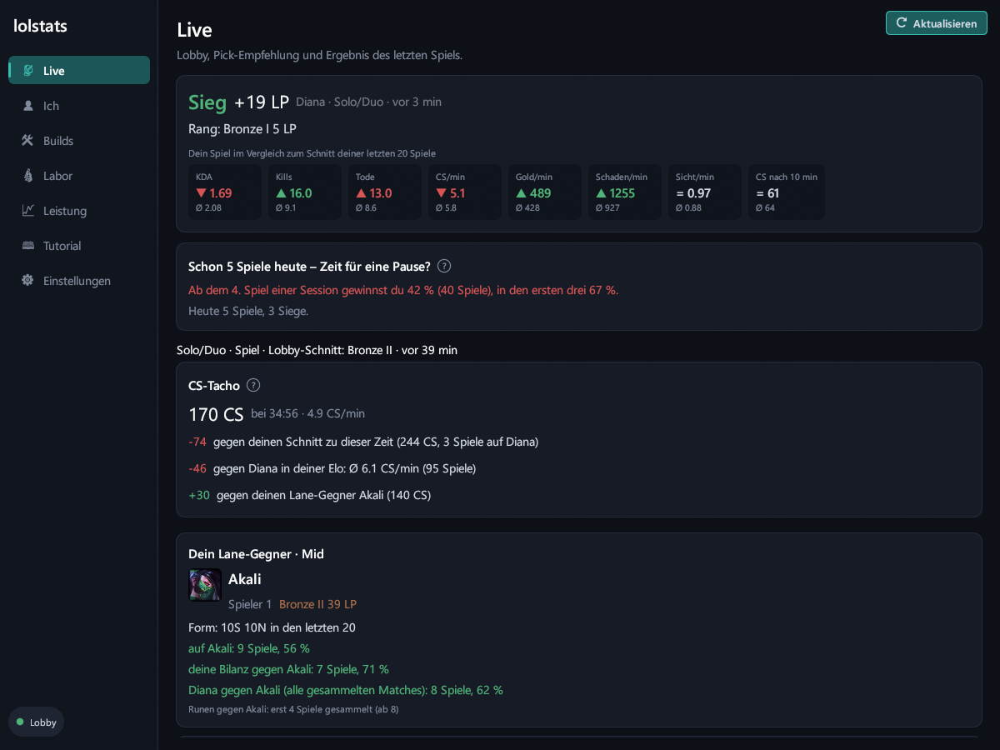
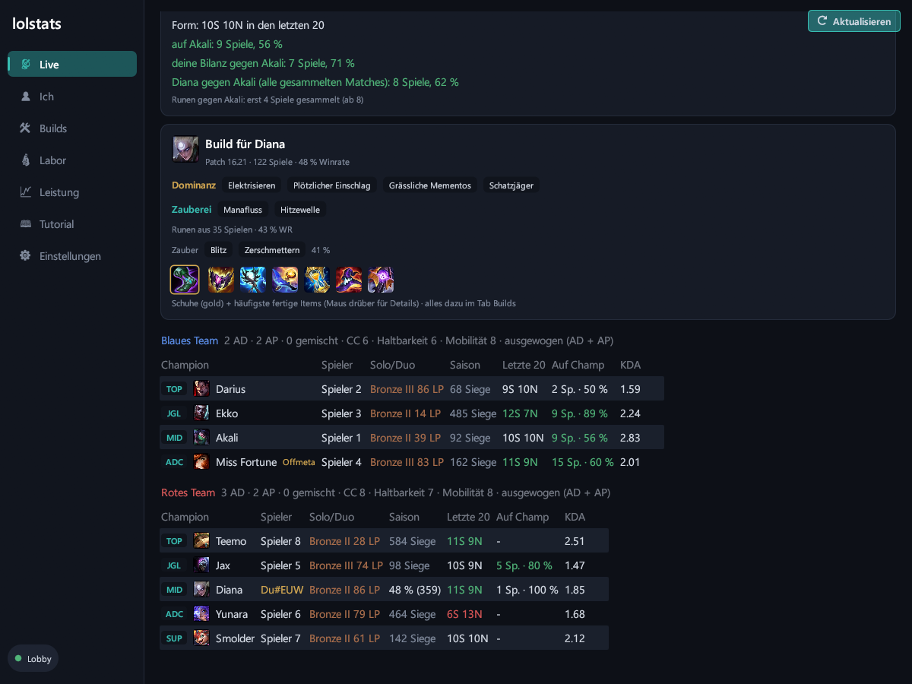
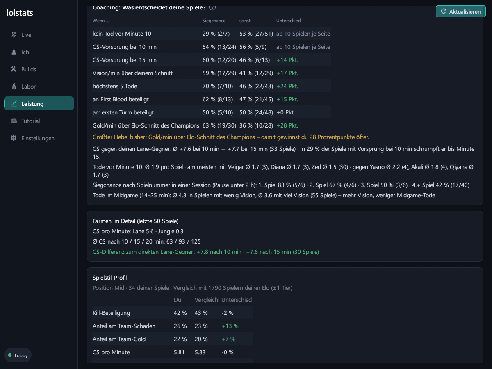
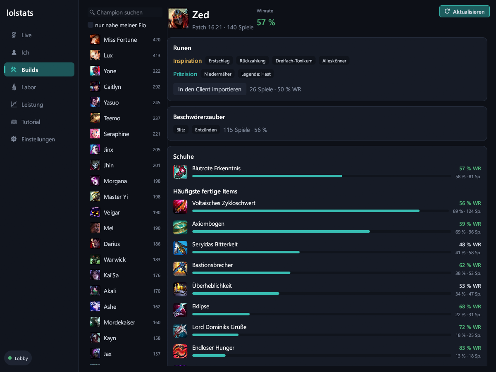

# lolstats

**Der schlanke League-of-Legends-Begleiter für Windows – nativ in Rust, ohne Overwolf, ohne Werbung, ohne Konto.**

lolstats läuft unauffällig im Tray, liest nur, was dein League-Client ohnehin anzeigt, und zeigt dir im eigenen Fenster, was dir beim Climben hilft: Lobby, Builds, CS-Tacho, Coaching und ehrliche Statistik über deine eigenen Spiele.

> *English:* lolstats is a lightweight, native Rust companion for League of Legends on Windows – a lean alternative to bloated Overwolf apps. No ads, no account, no upload: everything stays on your PC. The UI is currently German.

[](https://ko-fi.com/daviddev25)

---

## Warum lolstats?

| | lolstats | typische Overwolf-App |
|---|---|---|
| Installation | eine exe, ~8 MB | Overwolf-Plattform + App |
| Technik | nativ (Rust), kein Browser im Hintergrund | Chromium-basiert |
| Last im Spiel (gemessen) | ~0,1 % CPU, ~20 MB RAM für den Dienst | – |
| Werbung | keine | meist ja |
| Konto / Upload | nein – alles bleibt lokal | häufig |

## Funktionen

- **Live-Lobby** – beide Teams mit Rang, Form der letzten 20 Spiele und Erfahrung auf dem Champion, Offmeta-Picks markiert
- **Lane-Gegner-Karte** – Rang, Form, deine Bilanz gegen ihn, Matchup aus allen gesammelten Spielen, Warnung bei vielen frühen Toden gegen genau diesen Gegner
- **Builds & Runen** – Runen, Zauber, Schuhe und Items aus gesammelten Matches nahe deiner Elo, Matchup-Runen gegen deinen Lane-Gegner, Import in den Client per Klick
- **CS-Tacho** – im Spiel: dein CS gegen deinen eigenen Schnitt, den Elo-Schnitt deines Champions und deinen Lane-Gegner
- **Coaching** – was entscheidet *deine* Spiele? Siegchance mit/ohne frühen Tod, CS-Vorsprung, Vision, First Blood, Gold/min u. a.
- **Pausen-Hinweis** – nach Niederlagenserien oder langen Sessions, begründet mit deinen eigenen Zahlen
- **Labor** – Loser-Queue-Test (Mitspieler gegen Gegner nach Siegesserien, mit Zufallstest), Lobby-Stärke, Serien, Team-Kompositionen, alles als CSV exportierbar
- **Auto-Updates** – einmal am Tag, Installation per Klick, jede Datei per SHA-256 und Ed25519-Signatur geprüft

## Screenshots

| Live: Ergebnis, Pausen-Hinweis, CS-Tacho, Lane-Gegner | Live: Build und Lobby |
|---|---|
|  |  |
| **Coaching: Was entscheidet deine Spiele?** | **Builds aus Spielen deiner Elo** |
|  |  |

*Spielernamen auf den Bildern sind anonymisiert.*

## Installation

1. Neueste `lolstats.exe` unter [Releases](https://github.com/DavidDev25/lolstats-app/releases) laden und in einen eigenen Ordner legen.
2. Starten. Windows zeigt evtl. *„Der Computer wurde durch Windows geschützt“* → **Weitere Informationen** → **Trotzdem ausführen** (die exe ist nicht kostenpflichtig signiert; die SHA-256-Prüfsumme steht beim Release).
3. Tray-Symbol unten rechts: **Linksklick** öffnet das Fenster, **Rechtsklick → „Mit Windows starten“** für den Autostart.
4. League-Client starten – fertig. Im Fenster unter **Tutorial** steht alles Weitere.

## Datenschutz

- Daten kommen nur vom lokalen League-Client (LCU) und der Live-Schnittstelle im Spiel – **kein Riot-API-Schlüssel, kein Server, kein Konto**.
- Alles wird lokal in `%LOCALAPPDATA%\lolstats` gespeichert.
- Netzwerk nach außen nur für: Champion-/Item-Bilder (Riot Data Dragon), Update-Prüfung (GitHub) und – nur auf Klick – Ko-fi.

## FAQ

**Speichert lolstats meine Daten in der Cloud?**
Nein. Alles bleibt auf deinem PC in `%LOCALAPPDATA%\lolstats`. Es gibt kein Konto und keinen Server.

**Kann ich dafür gebannt werden?**
lolstats nutzt nur die offiziellen lokalen Schnittstellen des Clients, liest nur, was der Client ohnehin anzeigt, und greift nie ins Spiel ein. Es arbeitet nach Riots Richtlinien für Drittanbieter-Tools – eine Garantie kann allerdings kein Drittanbieter-Tool geben.

**Warum warnt Windows beim ersten Start?**
Die exe ist nicht mit einem kostenpflichtigen Zertifikat signiert. Die Echtheit sichern stattdessen die SHA-256-Prüfsumme und eine Ed25519-Signatur bei jedem Release. Der Updater installiert nur Dateien mit gültiger Signatur.

**Warum steht überall „zu wenige Spiele“?**
lolstats zeigt lieber nichts als etwas Falsches. Mit jedem Spiel werden die Auswertungen belastbarer. Lass den Client nach dem Spielen etwas offen, dann sammelt lolstats zusätzlich Matches für Builds und Vergleiche.

**Wie viel Leistung kostet das im Spiel?**
Gemessen: etwa 0,03 % CPU und 19 MB RAM für den Dienst. Das Fenster kannst du während des Spiels schließen, erfasst wird trotzdem alles.

**Gibt es eine englische Oberfläche?**
Noch nicht – ist geplant.

## Fair Play

lolstats ist rein passiv: Es greift nie ins Spiel ein, zeigt keine versteckten Informationen (z. B. gegnerische Cooldowns), deckt im Champ Select keine Mitspieler auf und berechnet keine eigenen Rang- oder Elo-Schätzungen.

## Selbst bauen

Voraussetzung: [Rust](https://rustup.rs) (Toolchain `stable-x86_64-pc-windows-gnu` mit MinGW oder `-msvc`).

```powershell
cargo test --release
cargo build --release
# Release-Paket (exe + Prüfsumme) auf dem Desktop:
powershell -ExecutionPolicy Bypass -File tools\release.ps1
```

## Lizenz

[MIT](LICENSE) – frei nutzbar, veränderbar und weitergebbar, solange der Lizenzhinweis erhalten bleibt.

## Unterstützen

lolstats ist kostenlos und bleibt werbefrei. Wenn es dir beim Climben hilft, freue ich mich über einen Kaffee: **[ko-fi.com/daviddev25](https://ko-fi.com/daviddev25)** ☕

---

*lolstats isn't endorsed by Riot Games and doesn't reflect the views or opinions of Riot Games or anyone officially involved in producing or managing Riot Games properties. Riot Games, and all associated properties are trademarks or registered trademarks of Riot Games, Inc.*
