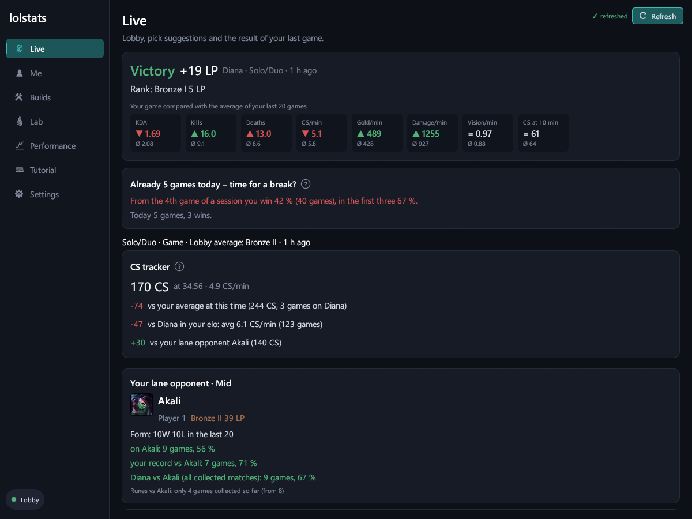
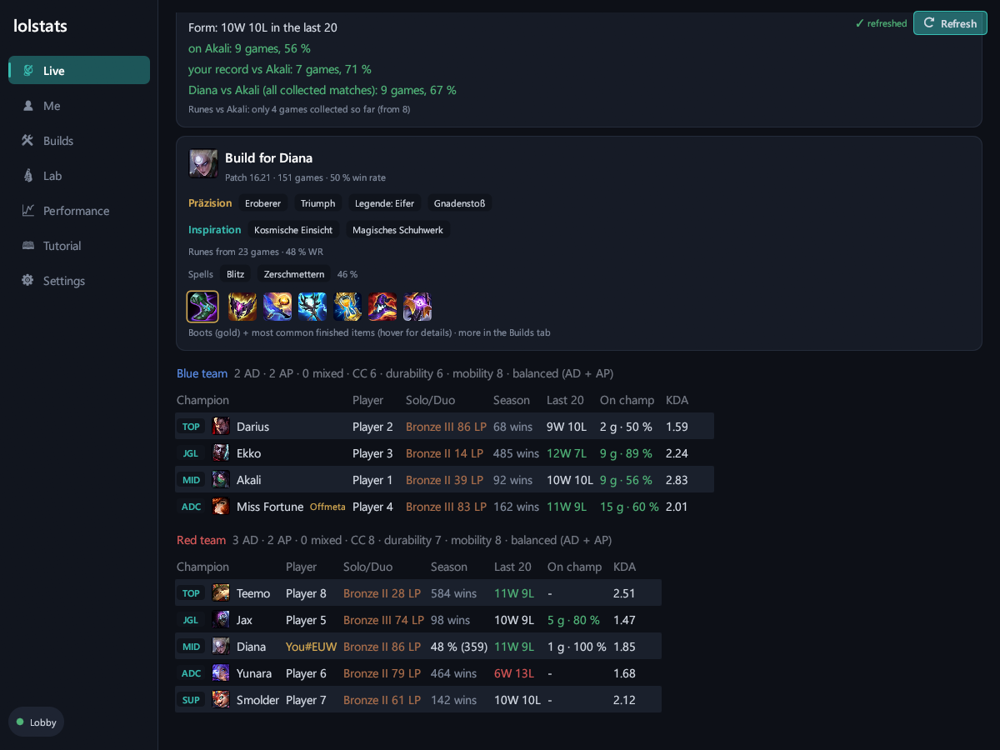
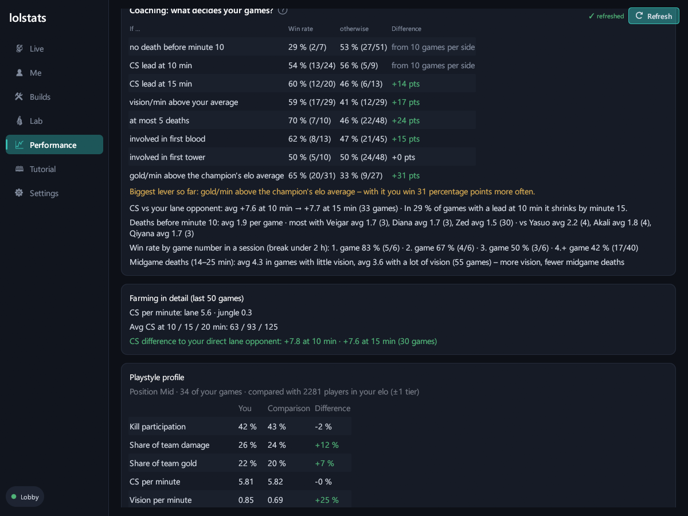
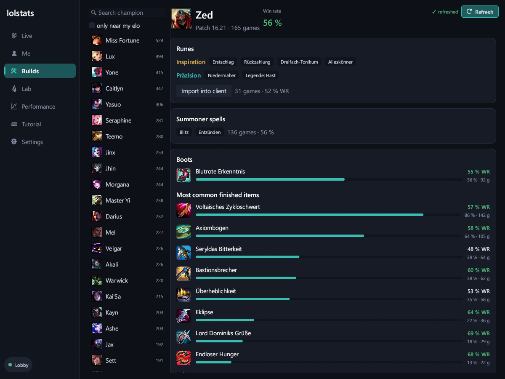

# lolstats

**The lean League of Legends companion for Windows – native Rust, no Overwolf, no ads, no account.**

lolstats sits quietly in your tray, only reads what your League client shows anyway, and shows you in its own window what helps you climb: lobby, builds, CS tracker, coaching and honest statistics about your own games.

> 🇩🇪 [Deutsche Version](README.de.md) · The app speaks English and German (Settings → Language).

[](https://ko-fi.com/daviddev25)

---

## Why lolstats?

| | lolstats | typical Overwolf app |
|---|---|---|
| Install | one exe, ~8 MB | Overwolf platform + app |
| Tech | native (Rust), no browser in the background | Chromium-based |
| Load in game (measured) | ~0.1 % CPU, ~20 MB RAM for the service | – |
| Ads | none | usually yes |
| Account / upload | no – everything stays local | often |

## Features

- **Live lobby** – both teams with rank, form of the last 20 games and champion experience, off-meta picks marked
- **Lane opponent card** – rank, form, your record against them, matchup from all collected games, a warning if you die early against exactly this opponent
- **Builds & runes** – runes, spells, boots and items from collected matches near your elo, matchup runes vs your lane opponent, import into the client with one click
- **CS tracker** – in game: your CS vs your own average, the elo average of your champion and your lane opponent
- **Coaching** – what decides *your* games? Win rate with/without early deaths, CS lead, vision, first blood, gold/min and more
- **Break hint** – after losing streaks or long sessions, backed by your own numbers
- **Lab** – loser queue test (teammates vs enemies after win streaks, with a random test), lobby strength, streaks, team compositions, everything exportable as CSV
- **Auto-updates** – once a day, install with one click, every file checked via SHA-256 and Ed25519 signature

## Screenshots

| Live: result, break hint, CS tracker, lane opponent | Live: build and lobby |
|---|---|
|  |  |
| **Coaching: what decides your games?** | **Builds from games in your elo** |
|  |  |

*Player names in the screenshots are anonymized.*

## Installation

1. Download the latest `lolstats.exe` from [Releases](https://github.com/DavidDev25/lolstats-app/releases) and put it in its own folder.
2. Start it. Windows may show *“Windows protected your PC”* → **More info** → **Run anyway** (the exe is not signed with a paid certificate; the SHA-256 checksum is listed with every release).
3. Tray icon at the bottom right: **left-click** opens the window, **right-click → “Start with Windows”** for autostart.
4. Start the League client – done. Everything else is explained in the window under **Tutorial**.

## Privacy

- Data only comes from the local League client (LCU) and the live interface during games – **no Riot API key, no server, no account**.
- Everything is stored locally in `%LOCALAPPDATA%\lolstats`.
- Outgoing network only for: champion/item images (Riot Data Dragon), update checks (GitHub) and – only when you click – Ko-fi.

## FAQ

**Does lolstats store my data in the cloud?**
No. Everything stays on your PC in `%LOCALAPPDATA%\lolstats`. There is no account and no server.

**Can I get banned for this?**
lolstats only uses the client's official local interfaces, only reads what the client shows anyway and never interferes with the game. It follows Riot's policies for third-party tools – but no third-party tool can give a guarantee.

**Why does Windows warn on first start?**
The exe is not signed with a paid certificate. Authenticity is instead secured by the SHA-256 checksum and an Ed25519 signature on every release. The updater only installs files with a valid signature.

**Why does it say “not enough games” everywhere?**
lolstats would rather show nothing than something wrong. With every game the analyses become more reliable. Leave the client open for a while after playing, then lolstats also collects matches for builds and comparisons.

**How much performance does it cost in game?**
Measured: about 0.03 % CPU and 19 MB RAM for the service. You can close the window while playing – everything is still recorded.

## Fair play

lolstats is purely passive: it never interferes with the game, shows no hidden information (e.g. enemy cooldowns), does not reveal teammates in champ select and calculates no rank or elo estimates of its own.

## How lolstats was built

lolstats is developed by DavidDev25 – with a lot of help from **[Claude Code](https://claude.com/claude-code)**, Anthropic's AI coding assistant. The idea, requirements, testing in real games and all decisions are mine; Claude wrote a large part of the code, the tests and the tooling (export, signing). From v0.2.0 on, Claude's contributions are credited as co-author in the commits.

## Build it yourself

Requirement: [Rust](https://rustup.rs) (toolchain `stable-x86_64-pc-windows-gnu` with MinGW, or `-msvc`).

```powershell
cargo test --release
cargo build --release
# Release package (exe + checksum + signature) on the desktop:
powershell -ExecutionPolicy Bypass -File tools\release.ps1
```

## License

[MIT](LICENSE) – free to use, modify and share as long as the license notice is kept.

## Support

lolstats is free and stays ad-free. If it helps you climb, I'd appreciate a coffee: **[ko-fi.com/daviddev25](https://ko-fi.com/daviddev25)** ☕

---

*lolstats isn't endorsed by Riot Games and doesn't reflect the views or opinions of Riot Games or anyone officially involved in producing or managing Riot Games properties. Riot Games, and all associated properties are trademarks or registered trademarks of Riot Games, Inc.*
